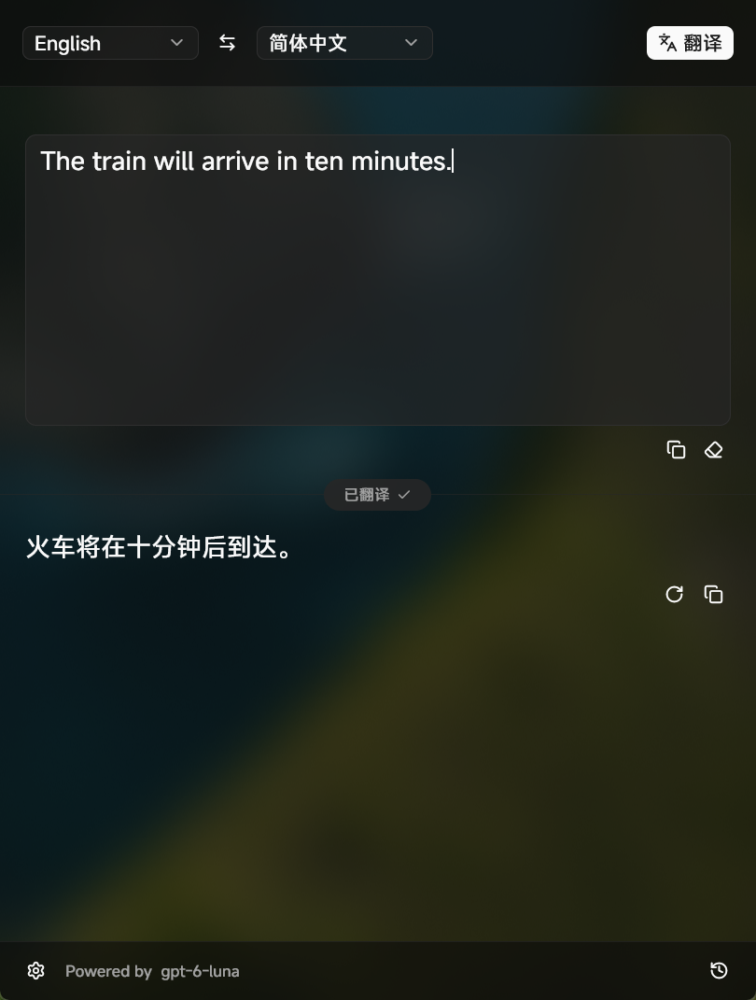

# NextAI Translator · Windows

用 Rust 和 [GPUI Kit](https://github.com/longbridge/gpui-kit) 重写的 [NextAI Translator](https://github.com/nextai-translator/nextai-translator) 翻译专用版。窗口使用 Windows 原生毛玻璃，保留原版的语言栏、上下对照编辑区、流式结果和底部工具栏；不依赖 WebView 或浏览器。



## 安装与更新

从 [GitHub Releases](https://github.com/JamesFlare1212/nextai-translator-rust/releases/latest) 选择 Windows x64 版本：`*-portable.exe` 是单文件版，放在自己有写权限的目录；`*-setup.exe` 安装到当前用户目录，提供开始菜单入口和卸载程序。两种版本都沿用下文的 AppData 设置和历史位置。

启动时后台检查 GitHub 最新稳定版，不向 GitHub 发送翻译或 API 密钥。有更新时，点底栏「软件更新」，或在设置顶部手动检查。点「下载更新」会下载与当前安装方式匹配的包，核对大小和 GitHub 发布资产的 SHA-256；点「重启并更新」才会关闭应用。便携版替换原路径的 EXE，安装版运行同目录升级。重启前请保存设置和所需草稿；尚未带有更新器的旧版需要手动升级一次。

[更新界面交互预览](docs/update-preview.html)可在浏览器本地打开，版本号和包大小为示例。

## 开始翻译

1. 运行 `nextai-translator.exe`。点左下角齿轮（`Ctrl+,`），默认服务是 `https://new-api.jamesflare.com`，模型为 `gpt-6-luna`。New API 和 OpenRouter 使用「自定义（OpenAI 兼容）」，升级时保留现有地址和密钥。切换提供商会保留各自的地址、密钥、模型、协议和思考开关；点「保存」后重启仍然有效，点「返回」则放弃本次修改。填写密钥并选择 API 协议。在「模型」下拉框中选择模型，或输入自定义名称并选中「使用…」，再点「保存」。
2. 输入或粘贴原文，按 **Enter** 或点「翻译」；**Shift+Enter** 换行。默认识别原文语言：中文译成英文，其他语言优先译成设置中的目标语言。也可以直接在顶部搜索、指定语言。单独提交一个词时会请求词典式译文。
3. 自动检测时默认将其他语言译成简体中文，中文则译成英语。可在设置中更改默认来源和目标语言；手动指定的目标优先。译文逐步显示。「停止」中断请求；连接失败或网关临时出错时，客户端最多自动重试一次。长译文只要持续接收数据，就不会被固定总时限截断；中途断流时自动重新请求一次，可能再次计费。等待期间保留已有译文，重试收到文字后从头替换，不会拼接重复内容；点「停止」可取消重试。结果下方可以重试或复制。交换箭头会把已完成的译文放回输入框并反向翻译。拖动中间的分隔线可调整上下区域。
4. 右下角可恢复或清空翻译历史；恢复记录不重新请求模型。设置支持跟随系统、浅色和深色外观。字体默认使用 [MiSans](https://hyperos.mi.com/font/zh/download/)，未安装时回退到 Windows 系统字体。设置中可搜索已安装字体，并调整原文和译文的字号（10–36 px）。下拉框展开或获得焦点时，只轻微加深或提亮原有边框，不显示外圈；文本输入框仍以光标表示焦点。

### 模型与本地数据

- 「API 协议」可选 Chat Completions（SSE）、Responses（SSE）或 **Responses（WebSocket）**。WebSocket 需要服务端支持 OpenAI Responses 的 `response.create` 事件；地址仍填写 HTTPS，翻译时自动改用 WSS，模型列表仍通过 HTTP 获取。若 New API 在首个 WS 事件中明确拒绝模型路由（`503 / model_not_found`），本次翻译自动改用同一地址的 Responses（SSE），并在状态栏标明，不修改已保存的协议。鉴权失败、额度不足或已经开始生成时不会触发协议回退。其他不支持 WebSocket 的服务请手动选择 SSE。支持 **Chat Completions** 和 **Responses API**，都可流式显示译文。API 地址可填写服务根地址、版本路径或完整端点；例如 `https://new-api.jamesflare.com`。地址框以浅色预览当前协议补全的路径，不改变填写或保存的地址。每次展开「模型」时按当前端点拉取列表，也可以点击右侧的刷新图标手动更新，不会改变当前选项。自动列表按服务声明的输出类型、接口及常见模型名过滤绘图、视频、语音、嵌入和重排等专用模型；保留支持文本翻译的视觉模型、未知名称及当前选择。在框内搜索不会重复请求；即使服务未列出模型或获取失败，也能在同一个下拉框中指定自定义名称。
- 「思考模型」用于请求模型的推理能力，是否支持取决于服务及模型。思考过程不作为译文展示。应用不内置密钥、远程模型配额或本地模型。
- 输入草稿不会发送请求。提交、重试或在有原文时切换翻译方向，才会把原文发送给所选服务。远程地址要求 HTTPS；仅本机回环地址允许 HTTP。密钥放在专门的字段，不放在 URL 中。
- 设置和最近 100 条成功翻译位于 `%APPDATA%\NextAI Translator Rust\`。密钥和历史正文使用当前 Windows 用户的 DPAPI 保护。清空历史不会删除设置。
- 只提供 Windows 桌面应用；没有浏览器插件、润色、总结、TTS、截图/OCR、生词本或记忆内容生成，也不监听其他应用的划词或剪贴板。

## 构建与测试

在 Windows x64 安装稳定版 Rust（MSVC）、Visual Studio C++ Build Tools 的「使用 C++ 的桌面开发」和 Windows SDK（包含 `fxc.exe`）。在项目目录运行：

```powershell
cargo fmt --all -- --check
cargo clippy --locked --release --all-targets --target x86_64-pc-windows-msvc -- -D warnings
cargo test --locked --release --all-targets --target x86_64-pc-windows-msvc
cargo build --locked --release --target x86_64-pc-windows-msvc
.\target\x86_64-pc-windows-msvc\release\nextai-translator.exe
```

[GitHub Actions](.github/workflows/windows.yml) 在推送和拉取请求时执行上述检查、构建 Windows x64 程序，并上传 `nextai-translator-windows-x64`。PR 与非默认分支只运行离线测试。推送到默认分支或在该分支手动运行时，CI 额外使用仓库 Secret `NEW_API_KEY` 执行实网测试；密钥缺失或测试失败会阻止打包。

每次 CI 还会生成 `windows-release-assets`（portable 和 Inno Setup 安装包），并静默安装、核对程序、卸载。正式发布时，先提交 `Cargo.toml` 与 `Cargo.lock` 中的新版本号，再给该提交打匹配的稳定版标签（例如版本 `0.1.10` 对应 `v0.1.10`）并推送标签。标签流水线通过后才将两个包作为同一个 GitHub Release 发布；普通分支和 PR 不发布。更新校验不是 Authenticode 签名，Windows 仍可能显示 SmartScreen 提示。

实网验收仅使用 `https://new-api.jamesflare.com` 和 `gpt-6-luna`。本地复测时，通过 T3 密钥卡获取临时文件，把**文件路径**设置为 `NEXTAI_TEST_KEY_FILE`，然后运行以下命令。它会检查模型列表，并分别测试两种协议的思考开/关，不输出密钥。

```powershell
cargo test --locked --release new_api_gpt_6_luna -- --ignored
```

实机布局和验证范围见[验收记录](docs/verification.md)。

## 来源

界面、语言选项与操作参照上游 [`3621e59`](https://github.com/nextai-translator/nextai-translator/tree/3621e591681de518718cc5bc9a1acf18ecd74b16) 的 `Translator.tsx`、`lang/data.ts`、`translate.ts` 和桌面窗口定义。简繁体识别字符表来自同一版本的 `traditional-or-simplified.ts`，应用图标来自 `src-tauri/icons/icon.ico`。本项目是独立定制版本，采用 [AGPL-3.0](LICENSE)。
